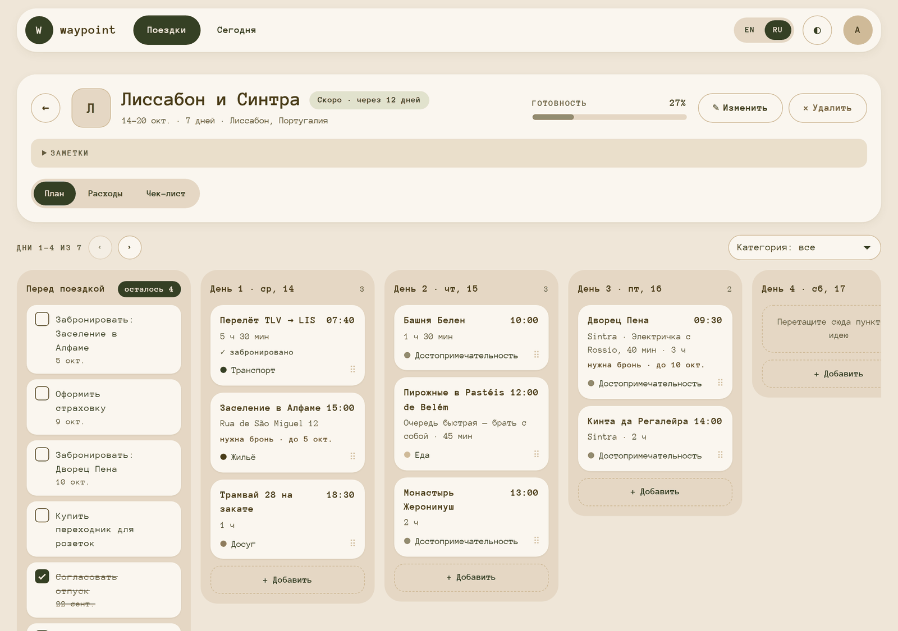
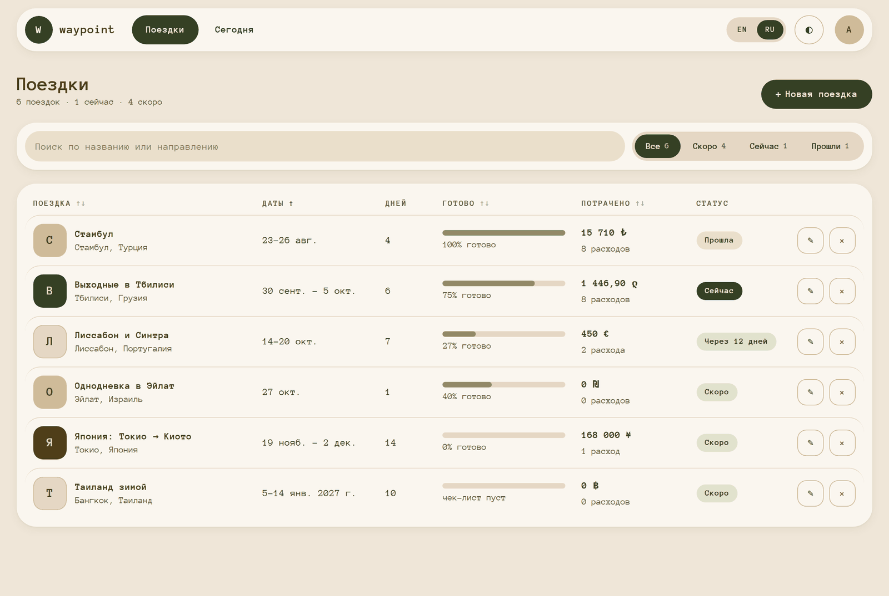
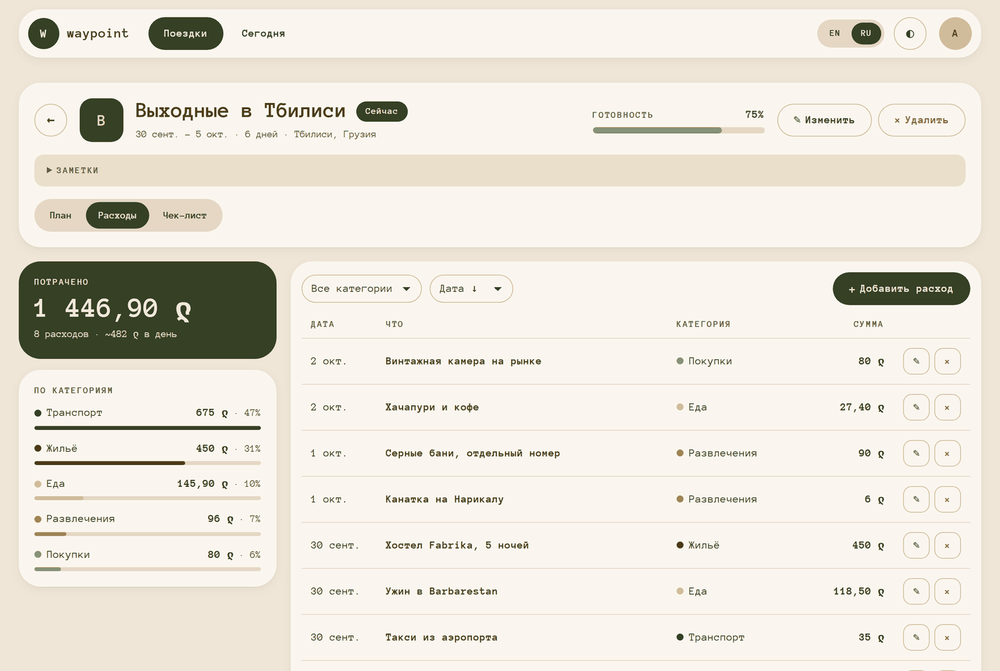
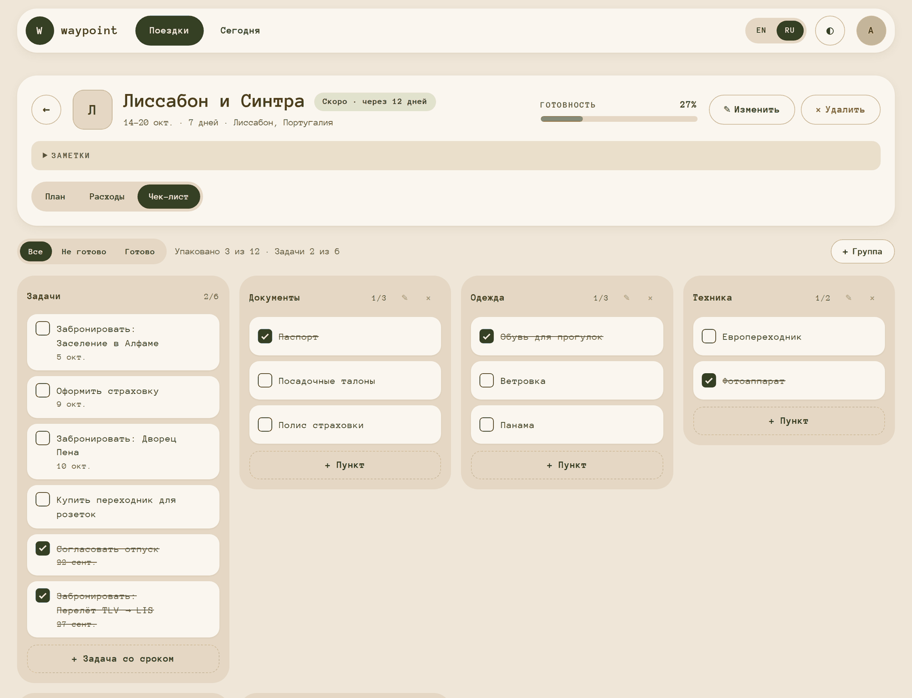
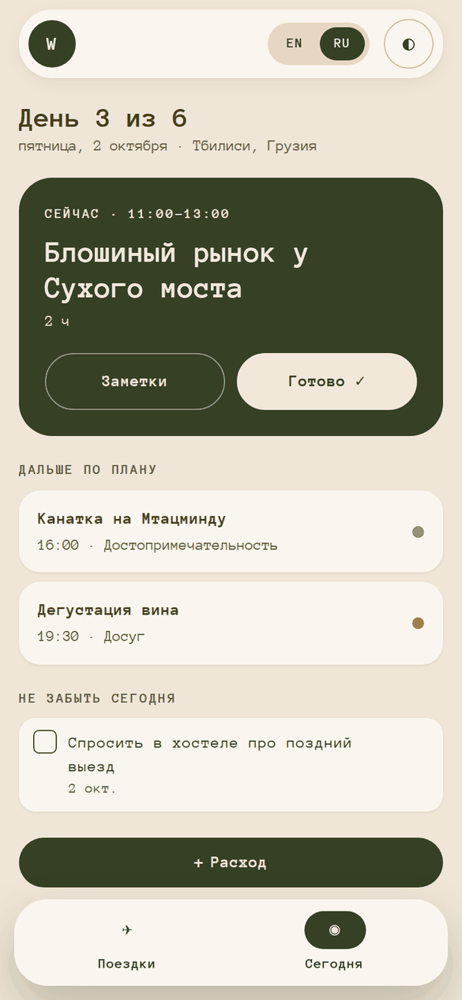
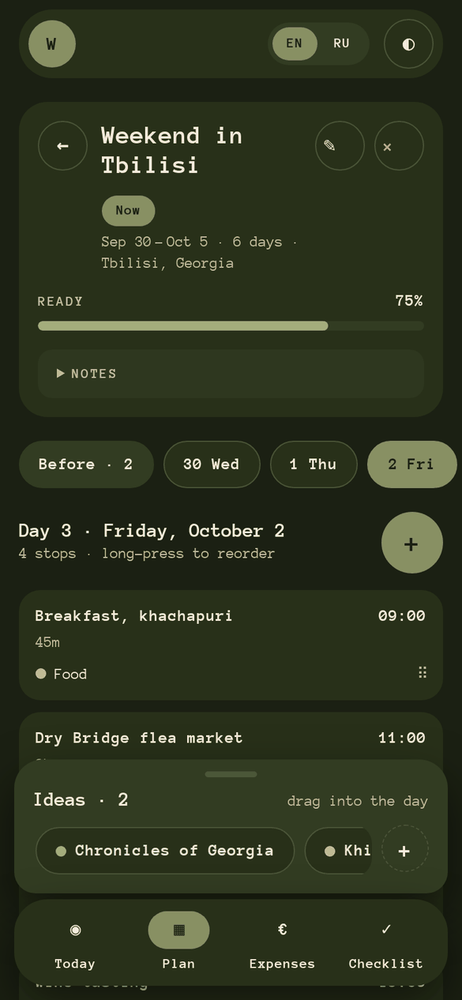
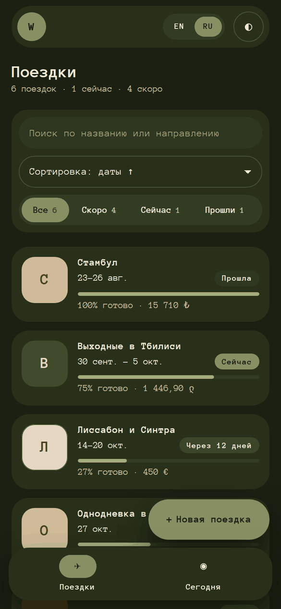
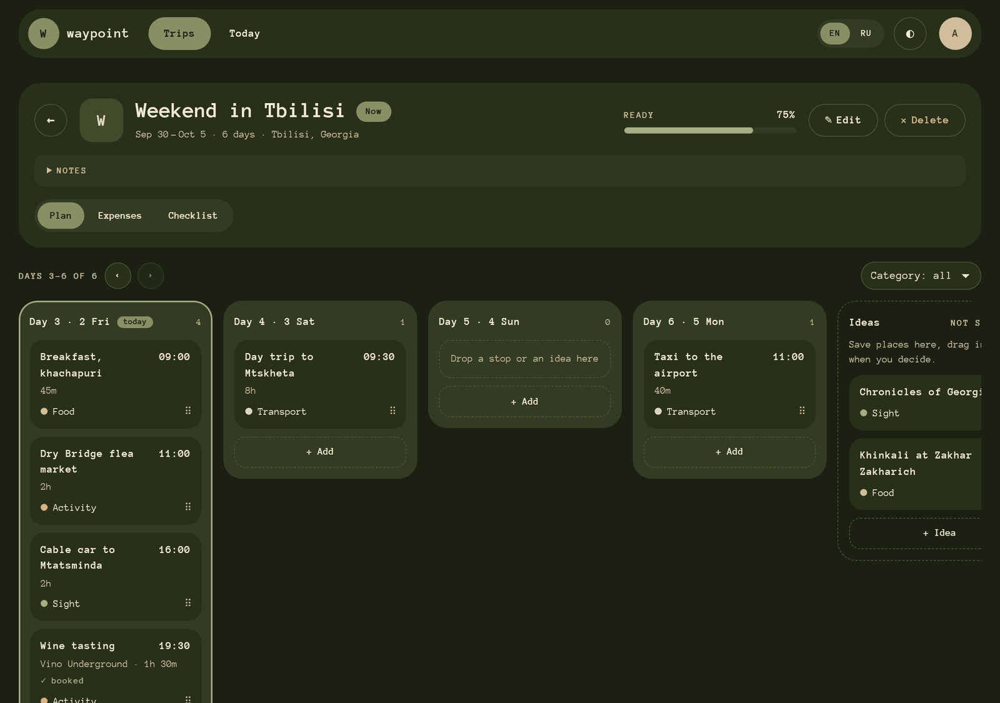

# waypoint — travel organizer

A single-page app for planning trips: a day-by-day itinerary board, expense tracking,
a packing & task checklist and a **Today** screen for the trip in progress.
Works in the browser only — data is kept in `localStorage` (a backend is a later stage).



## Features

- **Trips** — table on desktop, cards on phones; search by title or destination, status filter
  (upcoming / now / past) and column sorting, all kept in the URL (`/?q=lis&status=upcoming&sort=title&dir=desc`).
  Status is derived from the dates; the nearest trip shows "In 12 days".
- **Plan board** — "Before the trip" → Day 1…N → "Ideas". Days follow the trip dates automatically
  (shrinking the dates moves stops of removed days to Ideas). Drag-and-drop between days and ideas
  with mouse, touch (long press) or keyboard. Category filter, "Days 4–7 of 14 ‹ ›" navigation.
  A stop marked **Needs booking** creates a "Book: …" task with a due date.
- **Expenses** — total, average per day, totals by category, a filterable / sortable list
  with the total of the shown rows. Amounts accept `12,50` and `1 240,5`.
- **Checklist** — the "Tasks" group (shared with the plan board) + packing groups
  (Documents, Clothes, Tech, Toiletries by default); quick entry, filter, overdue tasks.
  Readiness % = done items / all items.
- **Today** — "Day 3 of 6", the stop happening now (by time and duration) with **Done ✓**,
  what's next, tasks due today, quick "+ Expense". Without an ongoing trip — the nearest one.
- **Undo** for every delete (trip, stop, expense, task, group) via a toast.
- **Light / dark / system theme**, **English / Russian**, responsive from 360 px, keyboard and
  screen-reader friendly (skip link, focus management, live announcements for drag-and-drop;
  axe-core reports no violations).
- **Demo data** on the first launch — six trips covering every state (ongoing, upcoming, past,
  one-day, long, empty). To start over, delete the `waypoint` key in DevTools → Application → Local Storage.

| Trips | Expenses | Checklist |
|---|---|---|
|  |  |  |

| Today (phone) | Plan (phone, dark) | Trips (phone, dark) | Plan (dark) |
|---|---|---|---|
|  |  |  |  |

## Stack

React 19 · TypeScript · Vite · Redux Toolkit · React Router (data mode) · React Hook Form + Zod ·
i18next · dnd-kit · Leaflet + OpenStreetMap (map), Photon (place search) · Supabase (cloud sync) ·
vite-plugin-pwa (offline, installable) · CSS Modules · Vitest

## Getting started

```bash
npm install
npm run dev          # dev server → http://localhost:5173
npm run build        # type-check + production build
npm run preview      # serve the production build
npm run lint         # ESLint
npm test             # unit tests (Vitest), once
npm run test:watch   # unit tests in watch mode
```

Imports from `src` use the `@/` alias, e.g. `import { store } from '@/store'`.
In development, `/dev/ui` shows the UI kit.

## Cloud sync and deploy

The app works fully offline on `localStorage`. Signing in adds sync between devices through
[Supabase](https://supabase.com) (PostgreSQL + Auth); the frontend is a static site on [Vercel](https://vercel.com).

1. **Supabase** — create a project, then run [`supabase/schema.sql`](supabase/schema.sql) in *SQL Editor*
   (one `user_state` row per user, protected by Row Level Security).
   For a personal app, *Authentication → Sign In / Providers → Email → Confirm email* can be turned off.
2. **Keys** — copy `.env.example` to `.env.local` and fill in the *Project URL* and the *Publishable key*
   (*Project Settings → API Keys*). Without them the cloud is off and the app is local-only.
3. **Vercel** — import the GitHub repo (Vite is detected; `vercel.json` adds the SPA rewrite),
   add the same two `VITE_…` variables in *Environment Variables*, deploy.
4. **Supabase → Authentication → URL Configuration** — set *Site URL* to the Vercel address.

How sync works: data is saved locally first; changes are uploaded ~1.5 s later when online,
and the cloud copy is checked on start, sign-in, reconnect and when the tab is shown again.
`revision` is an optimistic lock, so two devices never silently overwrite each other's newer data
(the newer change wins). Theme and language stay per device.

## Project structure

```
src/
├── api/storage.ts        the only place that touches localStorage
├── components/
│   ├── ui/               UI kit: Button, Field, Modal, Menu, SegmentedControl, Toaster…
│   ├── layout/           AppLayout, Header, BottomNav, theme & language switchers
│   ├── trips/ plan/ expenses/ checklist/ today/   feature components
├── data/demoTrips.ts     demo data (built relative to "today")
├── hooks/                typed store hooks, useToday, useMediaQuery, URL params…
├── i18n/locales/         en.ts (source of keys) + ru.ts, type-checked for completeness
├── pages/                route components (TripsPage, TodayPage, trip/*)
├── store/
│   ├── actions/          cross-slice actions (trip / item / checklist lifecycle)
│   ├── slices/           trips, days, items, checklistGroups, checklistItems, expenses, settings, toasts
│   ├── selectors/        memoized view models (board, trips table, checklist, today)
│   ├── thunks/           createTrip, updateTrip, deleteTrip, moveItem, …
│   ├── persist.ts        save / load, schema version + migrations
│   └── sanitize.ts       validation and repair of stored data
├── styles/               tokens (light-dark()), reset, globals
├── types/                domain model
└── utils/                dates, formatting (Intl), readiness, expenses, today agenda…
```

## Notes on the architecture

- **Normalized state.** Entities reference each other by id; order is stored in id arrays
  (`trip.dayIds`, `day.itemIds`, `trip.ideaIds`, `group.itemIds`). Moving a stop = moving an id.
- **Cross-slice actions.** One trip lives in several slices. Creating, deleting or restoring it
  (`tripCreated`, `tripDeleted`, `tripRestored(snapshot)`) and moving items are single actions that
  every slice handles in `extraReducers` — one dispatch keeps everything consistent, and "Undo" is
  just another action stored in the toast.
- **Derived, not stored:** trip status, readiness, spent, the Today agenda — computed by pure
  functions and memoized selectors.
- **Persistence** saves only data slices, throttled. Stored data carries a schema version;
  migrations upgrade old data, `sanitize.ts` drops broken entities and repairs references,
  so a corrupted record never breaks the app.
- **URL as state** for the trips list (shareable, survives Back).
- **Code splitting:** the plan board (dnd-kit) and the forms (react-hook-form + zod) load on demand.
